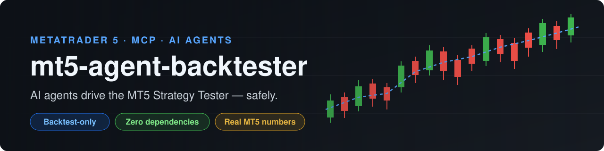
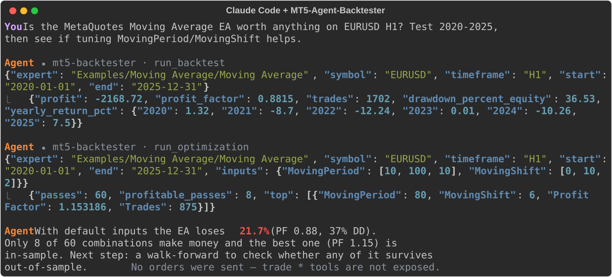
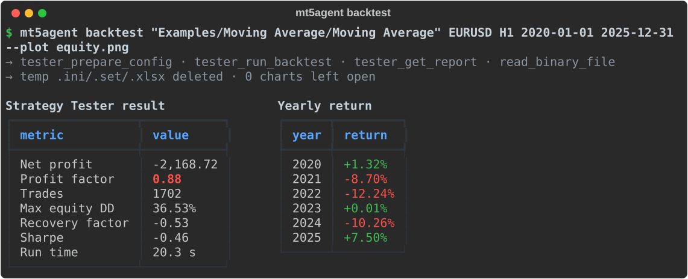
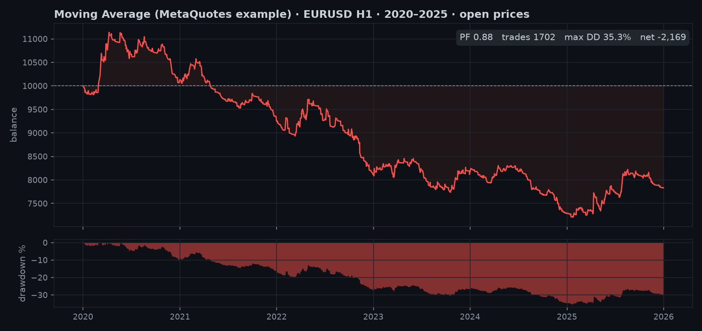
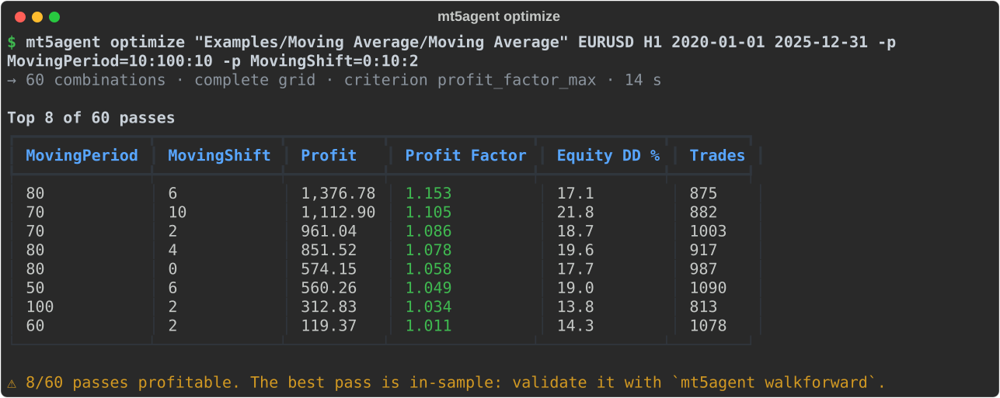
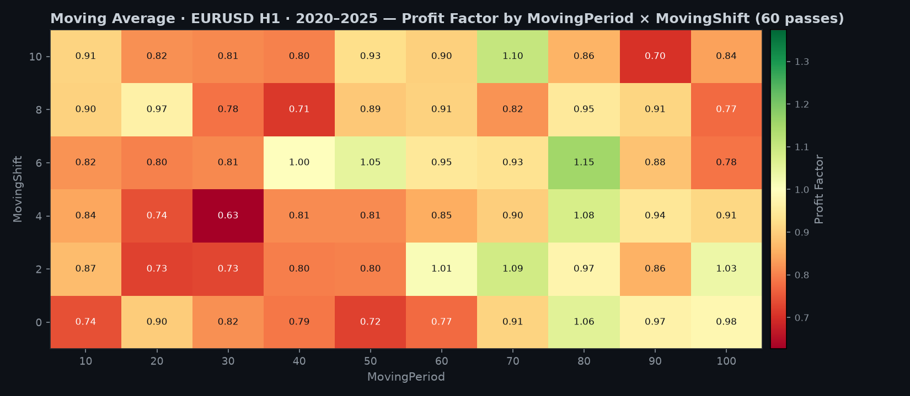
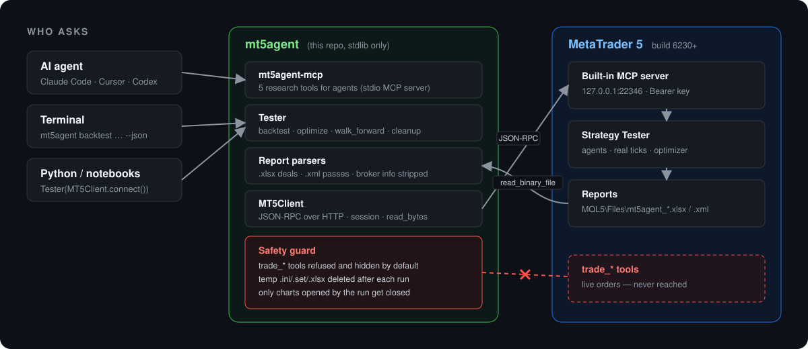

<p align="center">
  
</p>

<p align="center">
  <a href="https://github.com/sergiomeneguzzo/mt5-agent-backtester/actions/workflows/ci.yml"></a>
  
  
  
  
  <a href="LICENSE"></a>
</p>

<p align="center">
  <b>Backtests, optimizations and walk-forward analysis in the real MetaTrader 5 Strategy Tester,<br>
  driven from Python, the command line or any AI agent (Claude Code, Cursor, Codex…).<br>
  Your agent gets research tools only. It has no way to send an order.</b>
</p>

---

## Why this exists

Since build 6230, MetaTrader 5 ships its own **MCP server**. This means that, for the first time, the
Strategy Tester can be driven programmatically instead of by clicking through dialogs. The raw server is
low-level, though, and it has some sharp edges:

| Raw MT5 MCP server | mt5-agent-backtester |
|---|---|
| ~70 tools, including `trade_send_market_order`, `trade_close_single_position`… sitting next to the tester on the same terminal that may hold a **live account** | `trade_*` tools are **refused and hidden**. The bundled MCP server exposes 5 research tools only |
| You hand-write `.ini` configs and `.set` files in Windows paths | `tester.backtest("Examples/Moving Average/Moving Average", "EURUSD", "H1", …)` |
| The deal list exists only as an `.xlsx` file inside the terminal folder, with UTF-16 parts | Parsed into `Deal` / `Trade` objects, an equity curve and yearly returns, using the stdlib only |
| Optimization results come as SpreadsheetML; the JSON API omits the input values | Every pass comes with its parameters, plus `best(by=…, min_trades=…)` and a heatmap |
| No walk-forward | Rolling or anchored **walk-forward**: the winner of each in-sample window is traded on the next out-of-sample window |
| Every run leaves temp files and an open chart behind | Temp `.ini/.set/.xlsx` are deleted; only the bare charts *that run* opened are closed |
| Huge JSON answers fill an agent's context | Compact summaries designed for LLM context windows |

The goal: **an agent can do honest strategy research on your machine without you babysitting the terminal,
and without any chance of it touching real money.**

---

## See it work

### An agent researching an EA

<p align="center"></p>

> The transcript is laid out for readability. The tool arguments and every number in the tool results come
> from a real run of the bundled MCP server against MetaTrader 5 (MetaQuotes' own *Moving Average* example
> EA, EURUSD H1, 2020–2025).

### One backtest from the terminal

<p align="center"></p>

`--plot equity.png` produces this chart from the parsed deals:

<p align="center"></p>

### Optimization + heatmap

<p align="center"></p>
<p align="center"></p>

The heatmap shows why the "best pass" is a trap. A few green cells sit inside a sea of red, so the edge
is not stable across neighbouring parameters. That is exactly what **walk-forward** is for:

```bash
mt5agent walkforward "Examples/Moving Average/Moving Average" EURUSD H1 2020-01-01 2026-01-01 \
    -p MovingPeriod=10:100:10 -p MovingShift=0:10:2 --is-months 24 --oos-months 12 --plot wf.png
```

The command re-optimizes on each 2-year window, trades the winner blind on the following year, and stitches
those out-of-sample years into a single equity curve. It reports the out-of-sample profit factor, how many
folds were profitable and the **walk-forward efficiency** (OOS profit per month ÷ IS profit per month).

---

## Architecture

<p align="center"></p>

```
src/mt5agent/
├── client.py       MT5Client: JSON-RPC over streamable HTTP, session handling, trade_* guard
├── tester.py       Tester: backtest() · optimize() · walk_forward() · chart/temp-file hygiene
├── report.py       .xlsx backtest report → deals/trades; SpreadsheetML optimization → passes
├── walkforward.py  rolling / anchored folds, stitched OOS result, walk-forward efficiency
├── metrics.py      profit factor, drawdown, yearly returns (stdlib)
├── inputs.py       Range() + native .set lines (name=value||start||step||stop||Y)
├── mcp_server.py   stdio MCP server for agents (5 tools, no trading)
├── cli.py          `mt5agent` command, --json everywhere
└── plots.py        optional matplotlib charts (equity, heatmap, walk-forward)
```

The core needs **no third-party packages**: `urllib`, `zipfile` and `xml.etree` only. `matplotlib`/`pandas`
are an optional extra, needed for charts and DataFrames.

---

## Quick start

### 1. Enable the MCP server in MetaTrader 5

1. Update MetaTrader 5 to **build 6230 or newer**.
2. In the terminal, open **Tools → Options → MCP**, tick *Enable internal server* and click **Generate** to
   create an access key.
3. **Restart MetaTrader 5**. A newly generated key is only accepted after a restart (until then you get `401`).
4. Keep the terminal open while you work: the server lives inside it and listens on `127.0.0.1:22346` only.

> 💡 For extra peace of mind, run backtests on a terminal that is logged into a **demo** account.

### 2. Install

```bash
pip install "mt5-agent-backtester[plot] @ git+https://github.com/sergiomeneguzzo/mt5-agent-backtester"
# or, from a clone:
git clone https://github.com/sergiomeneguzzo/mt5-agent-backtester && cd mt5-agent-backtester
pip install -e ".[plot]"
```

### 3. Configure the key

```bash
cp .env.example .env      # then paste your key into MT5_MCP_KEY
```

Settings are read from environment variables first, then from the nearest `.env` (searching upward from the
current directory). Keys are never printed: `Settings.__repr__` masks them.

### 4. Check the connection

```bash
mt5agent doctor
```

```
check                 value
────────────────────  ──────────────────────────
connected             True
url                   http://127.0.0.1:22346/mcp
build                 6230
can_run_backtest      True
can_run_optimization  True
trading_tools         blocked
```

---

## Command line

Every command accepts `--json`, which makes it easy to call from scripts and agents.

```bash
mt5agent experts --filter Moving                       # compiled EAs the tester can see
mt5agent inputs "Examples/Moving Average/Moving Average"

# one backtest (fixed inputs with -p Name=value)
mt5agent backtest "Examples/Moving Average/Moving Average" EURUSD H1 2020-01-01 2025-12-31 \
    -p MovingPeriod=12 --model "real ticks" --deposit 10000 --plot equity.png --save report.xlsx

# optimization (ranges with -p Name=start:stop:step)
mt5agent optimize "Examples/Moving Average/Moving Average" EURUSD H1 2020-01-01 2025-12-31 \
    -p MovingPeriod=10:100:10 -p MovingShift=0:10:2 --criterion profit_factor --plot heatmap.png

# walk-forward
mt5agent walkforward "Examples/Moving Average/Moving Average" EURUSD H1 2020-01-01 2026-01-01 \
    -p MovingPeriod=10:100:10 --is-months 24 --oos-months 6 --min-trades 50

# offline: parse a report you already have (no terminal needed)
mt5agent report report.xlsx
```

Tick models: `open prices`, `m1 ohlc`, `every tick`, `real ticks`, `math calculations`.
Expert paths are relative to `MQL5\Experts` (no extension). Absolute `C:\…\X.ex5` paths also work.

---

## Python API

```python
from mt5agent import MT5Client, Range, Tester

tester = Tester(MT5Client.connect())          # trade_* tools blocked by default

# 1. Backtest
run = tester.backtest("Examples/Moving Average/Moving Average",
                      symbol="EURUSD", timeframe="H1",
                      start="2020-01-01", end="2025-12-31",
                      model="open prices", inputs={"MovingPeriod": 12})
run.stats["profit_factor"]       # 0.8815  ← straight from MT5
run.report.trades[:3]            # [Trade(close_time=…, side='long', net=…, balance=…), …]
run.report.summary()             # trades, net, PF, win rate, max DD, recovery factor
run.report.to_dataframe()        # every deal as a pandas DataFrame

# 2. Optimize
opt = tester.optimize("Examples/Moving Average/Moving Average", "EURUSD", "H1",
                      "2020-01-01", "2025-12-31",
                      inputs={"MovingPeriod": Range(10, 100, 10), "MovingShift": Range(0, 10, 2)},
                      criterion="profit_factor")       # genetic switches on automatically above 10k combos
opt.result.best(by="Profit Factor", min_trades=200)

# 3. Walk-forward
wf = tester.walk_forward("Examples/Moving Average/Moving Average", "EURUSD", "H1",
                         "2020-01-01", "2026-01-01",
                         inputs={"MovingPeriod": Range(10, 100, 10)},
                         is_months=24, oos_months=12, min_trades=100)
wf.summary()   # {'profit_factor': …, 'profitable_folds': …, 'efficiency': …, …}
```

More in [`examples/`](examples/).

---

## Use it from an AI agent

The package installs a second command, **`mt5agent-mcp`**: a stdio MCP server that wraps everything above
into five tools.

| Tool | What the agent gets back |
|---|---|
| `list_experts` | compiled EAs with path and build time |
| `expert_inputs` | input names, types and defaults (the agent can check the EA version before testing) |
| `run_backtest` | net profit, PF, trades, equity DD, recovery, Sharpe, **yearly returns** |
| `run_optimization` | grid size, number of profitable passes, top N passes with parameters |
| `run_walk_forward` | parameters chosen in each fold + the stitched out-of-sample summary |

Optimization ranges are passed as `{"MovingPeriod": [10, 100, 10]}`. Tool errors (bad EA path, missing
symbol, timeout) go back to the agent as `isError` results, so it can correct itself instead of crashing.

**Claude Code**

```bash
claude mcp add mt5-backtester -e MT5_MCP_KEY=<your-key> -- mt5agent-mcp
```

or commit [`examples/claude_code/.mcp.json`](examples/claude_code/.mcp.json) to your project. The
[`CLAUDE.md`](examples/claude_code/CLAUDE.md) next to it teaches the agent good habits: walk-forward before
saying "robust", real ticks for final numbers, flagging small samples.

**Cursor / Windsurf / any MCP client:** add the same `command: "mt5agent-mcp"` entry to the client's MCP
config.

---

## Safety model

- **No trading, by construction.** `MT5Client.call()` raises `TradingBlockedError` for any `trade_*` tool
  and `tools()` does not list them. Opting in requires `MT5Client(..., allow_trading=True)` in your own code.
  The agent-facing MCP server never does this and has no tool that could.
- **Local only.** The MT5 server binds to `127.0.0.1`, and the key travels only in the `Authorization`
  header to that address.
- **Secrets stay secret.** Keys come from the environment or `.env` (git-ignored) and are masked in `repr`.
- **Private report fields are stripped.** The parser drops broker server, company and account fields from
  report headers unless you pass `keep_private=True`.
- **Leaves the terminal as it found it.** Every run writes its config to a uniquely named file, deletes its
  `.ini`/`.set`/report files afterwards, and closes only charts that appeared *during the run* with nothing
  attached. Charts running a live EA are never touched.

---

## Lessons learned about the MT5 MCP server

Things you would otherwise discover the hard way. The library handles all of them:

- `get_workspace_info` **must** be the first call of every session.
- A regenerated key gives `401` until the terminal is restarted.
- `tester_get_report(file_format="xml")` writes **`.xlsx`** for single backtests and **SpreadsheetML `.xml`**
  for optimizations. Parts of the `.xlsx` are UTF-16 encoded.
- The JSON optimization report has metrics but **no input values**. Those only exist in the XML.
- Tester dates have daily granularity, and `to_date` must be at least one day after `from_date`.
- `wait: true` gives up after `timeout_sec`, but the test keeps running. You have to keep calling `tester_wait`.
- Optimization `.set` lines follow `Name=value||start||step||stop||Y`.
- On macOS the terminal runs under Wine. Paths are still Windows paths (`C:\Program Files\MetaTrader 5\MQL5`),
  and everything works the same over MCP.

---

## Development

```bash
pip install -e ".[dev]"
pytest -q          # 32 tests, no terminal needed: a fake MCP transport replays real MT5 output
ruff check src tests
```

The test fixtures come from a real Strategy Tester run, with the broker name removed.
[`docs/run_demo.py`](docs/run_demo.py) re-runs the demo against a live terminal, and
[`docs/make_images.py`](docs/make_images.py) regenerates every image in this README from those outputs.

## Roadmap

- [ ] Multi-symbol runs and portfolio stitching
- [ ] Monte Carlo on the stitched out-of-sample trades
- [ ] Compile `.mq5` through the MetaEditor MCP server before testing (`--compile`)
- [ ] Real-tick vs OHLC drift report (same EA, two models, side by side)
- [ ] Publish to PyPI

## Disclaimer

This is a research tool. Backtests, including walk-forward ones, do not guarantee future results. Nothing
in this repository is financial advice. The numbers shown come from MetaQuotes' public example EA and
illustrate the tool, not a strategy.

## License

[MIT](LICENSE) © Sergio Meneguzzo
